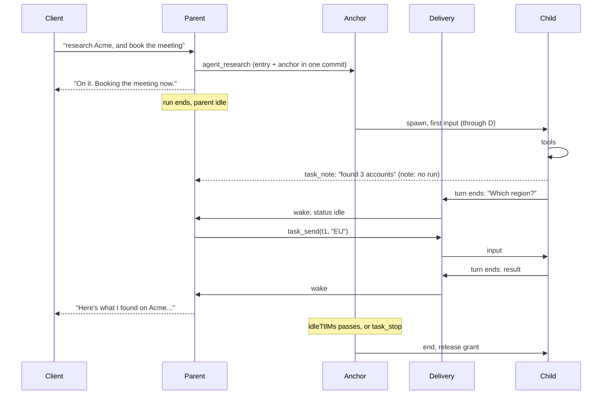

# Asynchronous tasks: parent and child messaging

Status: built, in `agent/tasks.ts`. Extends the sub-agents in [delegation.md](delegation.md).

## Problem

A sub-agent today is a tool call. That gives three limits:

| Limit | Effect |
|---|---|
| The parent blocks | A voice agent goes silent, and a steer waits, until the child ends |
| One message each way | The child gets `task`, the parent gets an answer. A child missing a fact can only guess or fail |
| Tied to the call | A barge-in aborts the child, so long work cannot survive the user changing the subject |

We want a child that runs while its parent keeps talking, and a way for each to reach the other while both are alive.

## Design in brief

1. **A background task is a sub-agent session owned by a background anchor task** in the parent's conversation, so it
   outlives the tool call and a barge-in, and still ends with the session.
2. **Messages are durable submissions into the other side's conversation.** There is no new mailbox: `pi.inbox`
   already orders, persists, dedupes by `requestId`, and places at safe boundaries.
3. **Three delivery levels**, each an existing durable behaviour: *wake*, *join*, and *note* (below).
4. **`app.tasks` on the parent is the source of truth** for what exists and how it ended. A transcript message is a
   notification, and can be compacted away.
5. **A child reports by ending its turn.** Results and questions take the same path, and nothing blocks while the other
   side thinks.

## Model-facing tools

A sub-agent with `"background": true` in config returns at once instead of waiting. Config decides, not the model,
because the two modes have different rules (see "The foreground deadlock").

```json
"subagents": { "research": { "description": "...", "model": "smart", "background": true, "idleTtlMs": 600000 } }
```

| Tool | Who | Does |
|---|---|---|
| `agent_<name>(task)` | parent | Starts the task; returns `{ taskId: "t1" }` |
| `task_send(taskId, message, urgent?)` | parent | Message a child. `urgent` joins its current run; otherwise it goes after that run |
| `task_list()` | parent | Every task's status and last report, from `app.tasks` |
| `task_stop(taskId)` | parent | Ends the task and its child conversation |
| `task_note(message, urgent?)` | child | Tell the parent something mid-run, and keep working |

There is deliberately no `task_wait` and no blocking `ask_parent`:

- To wait, the parent ends its turn and is woken by the report. Waiting costs nothing and holds no tool round.
- To ask, the child ends its turn with the question as its answer. The parent replies with `task_send`, which starts the
  child's next run. The child is idle, not parked in a tool call, so the question survives a restart for free.

## Delivery levels

| Level | Durable call | Parent idle | Parent busy | Used for |
|---|---|---|---|---|
| **wake** | `input`, `whenBusy: "followUp"` | Starts a run | After the run answers | A child's turn ended |
| **join** | `input`, `whenBusy: "steer"` | Starts a run | After the current tool round | `urgent: true` |
| **note** | `write` with `model` | Waits for the next input; no run, no spend | Next boundary | `task_note`; a report past the wake budget |

The same levels apply from parent to child, except that a child is not given notes. `task_send` is wake or join.

A report reaches the model as a user-role message, because durable has no other way to start a run. So it is marked as
data, in its own entry kind:

```xml
<task_report id="t1" name="research" status="idle" still_working="t2">...</task_report>
```

The entry kind is `app.task-report`. A prompt section says these come from sub-agents, not the user, and are not
instructions. The child's text has its closing tag escaped. See "Trust".

## State

`app.tasks`, a conversation document on the parent:

```ts
type TaskEntry = {
	id: string;              // "t1", per session: short, for the model
	name: string;            // the sub-agent
	status: "working" | "idle" | "stopped" | "failed" | "expired"; // failed: the last run failed; the child can be retried
	child?: ConversationId;  // absent until the anchor creates it
	anchor: TaskId;
	call: TaskId;            // the starting tool call, so a rerun finds this entry
	pending: number;         // inputs not settled; working until the last one, so each still reports
	runAt: number;           // when the current run started, for its deadline
	timedOut?: boolean;      // that deadline passed, so what the run settles as is a timeout
	answer?: EntryId;        // newest answer reported; a steer and the input it joined share one
	notes?: number;          // notes since the child last settled an input
	heardAt?: number;        // the first user input after it stopped, which starts the idle clock
	sends: TaskId[];         // recent task_send calls, so a rerun does not send twice
	origin?: { turnId: string; traceparent?: string }; // the turn that last gave it work; copied to the child's session
	lastReport?: string;     // bounded, and marked if cut; what task_list returns after compaction
	startedAt: number;
	activeAt: number;
};
type TasksState = {
	tasks: TaskEntry[];
	nextId: number;
	unattended: number;      // runs tasks started since a user last spoke
	attendedTokens: number;  // what the session had spent when a user last spoke
	droppedUsage?: Usage;    // the spend of tasks dropped from `tasks`
};
```

The child's `SessionDoc` gains `task: "t1"`, which marks it as a background child, and `parent` is already there. The
anchor is created in the same commit as the entry, so a rerun of the starting tool finds it, and the limit check cannot
race. Unlike `ChildSlots`, this count is durable, so resumed tasks are counted from the start.

## Tasks

| Task | Owner | Phases |
|---|---|---|
| `app.task-anchor` | Parent's conversation, `background: true` | `spawn` → `watch` ⟲ (`timeout`) → `finish` → `report` |
| `app.task-delivery` | The anchor | `deliver` → `report` |

**Anchor.** `spawn` creates the child (owned by the anchor), its session, and its grant. `watch` sleeps until the next
deadline, then enforces it. It needs no running invocation, and the deadlines are stored, so they survive a restart,
which `runChild`'s `setTimeout` does not. Durable cannot move a sleep, and a send can bring a deadline closer, so `watch`
also wakes every quarter of the shorter of `timeoutMs` and `idleTtlMs`. That bounds how late a deadline can be enforced.
Its abort handler marks the entry `stopped` and releases the grant. A process
stop writes the task back as pending without running that handler, so the `stopping()` workaround is not needed here.

| Deadline | Default | At expiry |
|---|---|---|
| `timeoutMs`: one run | 300000 | Abort the child's run; the delivery reports the timeout |
| `idleTtlMs`: idle child awaiting a reply, from the first user input after it stopped | 600000 | End it, `expired`, a note to the parent |
| `maxLifetimeMs`: the whole task | 3600000 | End it, `expired`, a wake |

The idle clock waits for a user because a child's question may reach nobody until then: a report can be a note, or the
parent can relay the question and the user take a while. With nobody there, `maxLifetimeMs` is what ends the task, and it
holds its grant until then.

**Delivery.** One per input to a child, as in durable's example 23. `deliver` submits the input and waits for it to
settle, and decides in that commit whether the report wakes the parent or is a note, so a rerun agrees. A report's
`status` comes from the child's `pi.live` and `pi.inbox`, not `pending`: a steer that joined the run settles just after
the input it joined, and no report follows it. A task not yet submitted is not visible there, so a report can say `idle`
with another on the way, which is the harmless direction. `report` posts the outcome and waits for it to settle. The
anchor's own reports use the same `report` phase, and an urgent note is a delivery that starts in it, so a limit or a
barge-in treats it as it does a report.

`deliver` takes a background run slot first. Refused, it sleeps a second and tries again, moving `runAt` so the wait does
not spend the run's deadline. It looks at the task again each time, since the task may have ended meanwhile.



## Delivery guarantees

Each message is delivered exactly once to the transcript, or the sender is told it could not be.

| Case | Handling |
|---|---|
| Crash between steps | Every submission has a `requestId` naming its cause, and durable dedupes per conversation |
| A report's identity | `report:<answer entry id>`, and `TaskEntry.answer`, so a steer and the input it joined produce one report and spend one run |
| A failed child run | `report:failed:<submission id>`, with the reason |
| Barge-in withdraws a queued report or urgent note | `report` sees `unanswered` with no `entry`, meaning it was never placed, and reposts as a note under a new id (`...:note`), since a withdrawn id stays dead. A queued write survives an abort |
| Report placed, then its run aborted | `unanswered` with an `entry`: already in the transcript, so nothing to do |
| Send to a stopped task | Refused by status in `app.tasks`, with an error the model reads. This check is required: durable accepts input to a conversation whose anchor has ended, and runs it |
| Parent closed | Children are already ended (below); a child's `task_note` sees `closed` and errors |
| Crash loop | A parked anchor or delivery shows through `parkedTasks`, since children are found by owner. `session.retry` runs it |

## Lifecycle

| Event | Effect on tasks |
|---|---|
| `session.interrupt`, plain `session.cancel`, barge-in | None. Surviving these is the purpose. Queued reports fall back to notes |
| `session.cancel` with `tasks: true` (new) | `abort(context, { background: true })` |
| `session.update` with `archived: true` | Same, and the current run stops too. Nothing should spend in a session that is out of the way, and an idle task could not hear from anyone. A report already on its way is held as a note, so restoring shows it |
| `session.close` | Same. Today's `close()` uses a plain abort, which would leak running children |
| Restart | Anchors and deliveries resume from storage; child runs resume with `harness.resume()` |
| Transient session (`runTask`, MCP) | Refused. The session closes at its answer, so nothing could read a report. `SessionDoc` must record `transient` |

## The foreground deadlock

A foreground parent is inside a tool call waiting for its child. A wake or join to that parent is queued until the tool
round ends, and the tool round ends when the child does, so a child that waits for a reply never gets one. The spike
confirmed the follow-up is never placed while the tool waits.

So `task_note` works only in a background child, which is what `SessionDoc.task` marks, and a foreground child gets an
error telling it to put the question in its answer. A background child cannot hit this: its parent is never waiting in a
tool for it, because no `task_wait` exists. That is the main reason there isn't one.

## Limits

An unattended agent spends money with nobody watching, and a parent and child can trade messages forever.

| Limit | Default | Past it |
|---|---|---|
| `limits.maxTasksPerSession` | 5 live | `agent_<name>` returns an error the model can act on |
| `limits.maxBackgroundRunsPerUser` | 3 | A child's run waits for a slot, and its deadline waits with it |
| `limits.maxUnattendedRuns` | 10 | Reports become notes until the next user input, which resets `unattended` |
| `limits.maxUnattendedTokens` | 1000000 | The same, once the session has spent this many tokens since the last user input, background tasks included. Cache reads are not counted: they are cheap, and repeat on every request |
| Notes | 10 per input given to the child, 2000 characters each | `task_note` returns an error, and a long note is cut. A plain note starts no run, so nothing else limits it |
| Report text | 20000 characters | Cut, and marked as cut |
| `maxConcurrentRunsPerUser`, `maxConcurrentRuns` | as today | A wake takes a `RunTracker` lease. If refused, it sleeps a second and retries: delayed, not lost |

A run counts toward `maxUnattendedRuns` when it wakes, but one run can send to every task, so runs alone say little about
cost. `maxUnattendedTokens` is the limit on that. Both only stop wakes: a child already running goes on to its deadline, so
a session can pass the token limit by what its running children spend. An urgent note spends from these as a report does.

A foreground child runs inside its parent's lease. A background child outlives that lease, so it takes its own, counted
by owner against `maxBackgroundRunsPerUser`. That limit is separate from `maxConcurrentRunsPerUser` because sharing it
would let three working tasks refuse the person talking to the session, which is what background work is meant to avoid.
Child runs do count toward `maxConcurrentRuns`, the server's capacity. A `RunTracker` is in memory, so a run resumed after
a restart counts again only once its delivery reruns.

## Spend

A foreground child's spend reaches its parent's `usage` through the tool result. A background task has none, so
`session.get` gives each task's `usage`, read from the child, and `taskUsage`, their total. A session's whole spend is
`usage` plus `taskUsage`. As with `usage`, it cannot be read once the session closes.

## Trust

- **A report can carry a prompt injection.** A child that read a hostile page can write anything into its report, and
  the report is a user-role message. Marking it as data, with any `task`, `task_report`, or `task_note` tag in its text
  escaped, reduces this but does not stop it, and a parent may hold stronger
  tools than the child. Grants remain the boundary: a child's grant is narrowed, and any parent tool that acts for the
  user must be safe to call on untrusted text, as it must be for a tool result today.
- **Only parent and child can talk.** `task_send` resolves ids through the caller's own `app.tasks`, and `task_note` goes
  only to `session.parent`, so no id can reach another session. Siblings relay through the parent.
- **A client's `note` goes through `beforePrompt`** as `turn.note`, apart from `input` and `text`: it reaches the model,
  so a plugin that filters input must filter it, and must not treat it as something the person said.
- **`beforePrompt` does not run** for a report, the same rule as a child's input. Guardrails' `afterToolCall` has already
  cleaned what the child saw. `afterRun` does run for a woken run, and a crash can call it twice.

## Identity, tracing, and clients

- **Turn.** A foreground child bills to its parent's current turn, which is wrong once a child outlives it. A background
  child uses `origin`, from its session: the turn that started it, then each turn that sends it work. A send while it
  runs moves the rest of that run to the new turn. A woken run gets its own `turnId`,
  `task-<id>-<submission>`, in the origin's trace, recorded with the wake.
- **Grant.** The child's grant lasts until the anchor ends. It cannot outlive the parent's, and only user requests extend
  that, so a long task with the user away can run out. The model sees the existing expiry error and reports it.
- **Credentials.** A session's principal is swept after 30 minutes without a request. While a task is `working`, each
  `watch` keeps the parent's and copies it to the child, so plugins and audit headers still see the user and a token the
  client refreshed reaches the child. Each delivery copies it too, so a child that sat idle past the sweep, or across a
  restart, gets the user back with its next input. An expired token is dropped either way.
- **Client events.** The hub watches `app.tasks` and emits `task.updated { taskId, name, status }` when a status changes.
  `watchDoc` does not create a document, so `AgentService.hub` does. `session.get` gains `tasks`, and `snapshot` carries
  them too.
  A woken run streams as any run does, but only to a `GET` stream, since no prompt response is open. A client that wants
  unprompted answers must hold one. The next client that connects reads the rest from the
  transcript, where reports and notes are `task` lines rather than `user` ones.
- **Voice.** A woken run speaks unprompted. A profile can set `"taskReports": "note"` to hold every report and urgent note
  for the next user input. The default is `"wake"`.

## Alternatives rejected

| Alternative | Why not |
|---|---|
| Polling tool (`task_inbox`) | Spends a model call per check, and is only as prompt as the model remembers to be |
| `task_wait` / blocking `ask_parent` | Holds a tool round, which blocks steers, and brings back the foreground deadlock |
| Our own mailbox document | Rebuilds ordering, placement, and dedupe that `pi.inbox` has, then still needs a run to deliver it |
| In-memory event bus | Lost on restart, and a run can outlive a process |
| Shared blackboard document | Nothing tells a reader it changed, and it is a channel between siblings that no grant governs |

## Known weakness: fan-in

Three tasks finishing means three wakes, each a model call, though the first two may have nothing to do. `still_working`
lets the model hold off, but it still spends the call, and a voice agent may say something empty. We accept this for
now. If it hurts, add a `group` to the start call, with one delivery holding reports until the group ends. That changes
only the delivery task.

## Build order

Each step lands with its tests.

1. **Task core** (`agent/tasks.ts`): `app.tasks`, both tasks, `"background"` config, start and report. Refuse on transient
   sessions. `close()` aborts background work.
2. **Messaging**: `task_send`, `task_note`, `task_list`, `task_stop`, the status checks, the prompt section.
3. **Hardening**: the barge-in fallback, deadlines, `maxUnattendedRuns`, `RunTracker` leases, `session.cancel` with `tasks`.
4. **Surfaces**: `task.updated`, `session.get`, turn and trace, `taskReports`, docs.

The task tools reach the harness through a lazy `harness()` dep, since it is built after the extension, for two things
`ToolExecutionApi` does not offer: `abortTask` for a task the tool does not own, and a queued `write`, because
`ConversationHandle.submit` takes inputs only. The parent is offered `task_send`, `task_list`, and `task_stop` from its
first task on, appended to `pi.agent.tools` directly so they cannot be evicted. A child that fails to start is `stopped`,
not `failed`: there is nothing to retry.

Depth stays at one level. Nothing above depends on it: a report goes to `session.parent` and a stop cascades by ownership.
Lifting it means changing the guard in the start path and counting budgets at the root. Tasks across agents, over MCP,
are out of scope, since `transport/mcp.ts` is one-shot.

## What is verified

A spike against pi-durable 1.4.0, on SQLite with faux models, confirmed these:

- A tool can start a background anchor; the parent's run ends and `waitForIdle` returns while the child runs.
- A report on an idle parent starts a run, under a custom entry kind.
- A `write` with `model` starts no run when idle, is queued when busy, and reaches the next request.
- `requestId` dedupes writes as well as inputs.
- A tool in a child can steer its parent; the steer lands at the parent's tool-round boundary.
- A plain `abort()` leaves background work running; `{ background: true }` ends a sleeping anchor, its delivery, and a
  running child, and runs the abort handler.
- A child resumes after a restart and reports exactly once.
- A follow-up cannot reach a parent blocked in a tool.
- `abort()` withdraws a queued report (`unanswered`, `aborted`), keeps a queued write, and leaves that `requestId` dead.
- An idle child takes a second input while its anchor sleeps, and `abortTask` ends a sleeping anchor.
- A child still accepts input after its anchor ended.
- A steer and the input it joined settle on the same answer entry, which the report's `requestId` relies on
  (`test/tasks.test.ts`).

These paths are not tested: `droppedUsage` and the hub forgetting a dropped task, which need more than 20 ended tasks; a
failed `store.touch` after an input is admitted; and a send landing during a timeout's abort, which is a narrow race.
