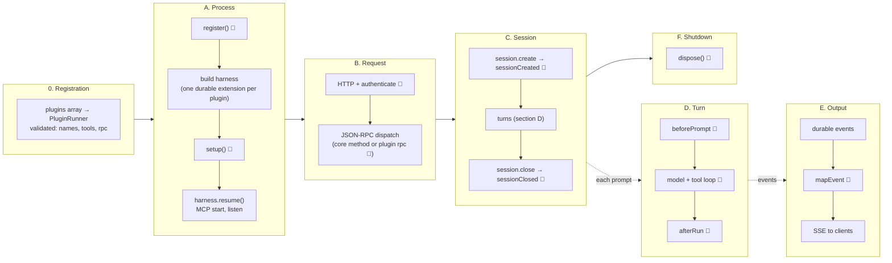
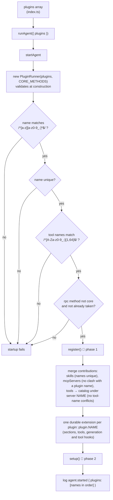
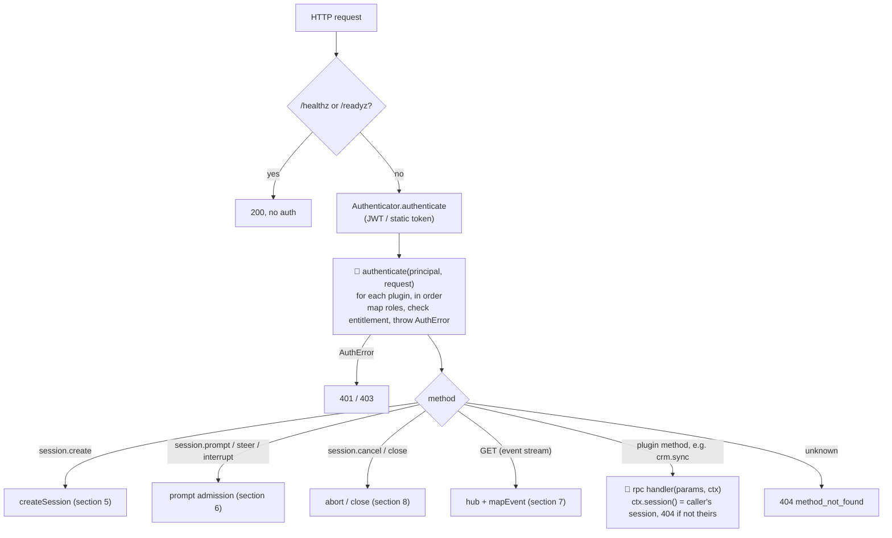
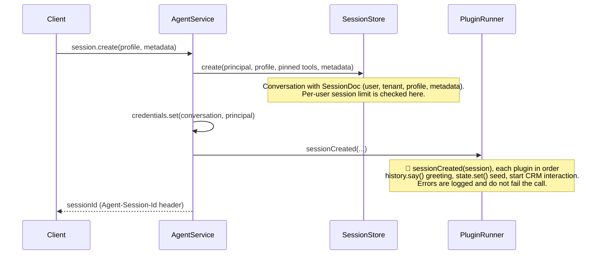
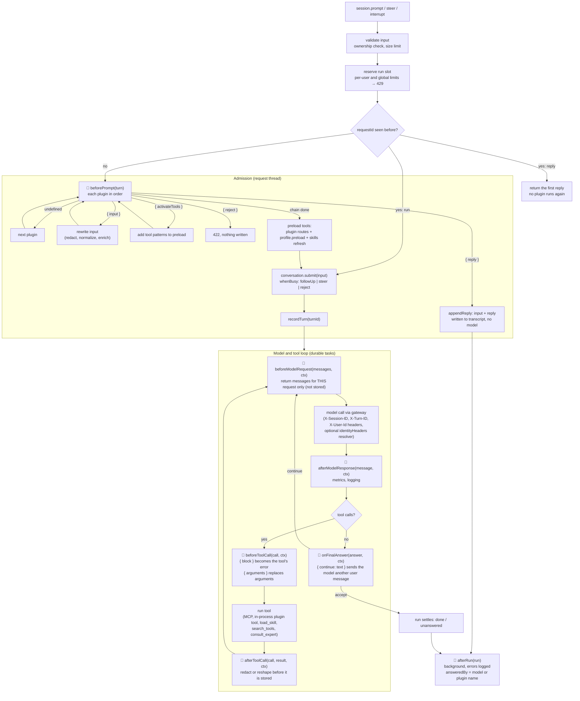
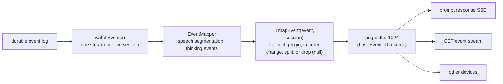
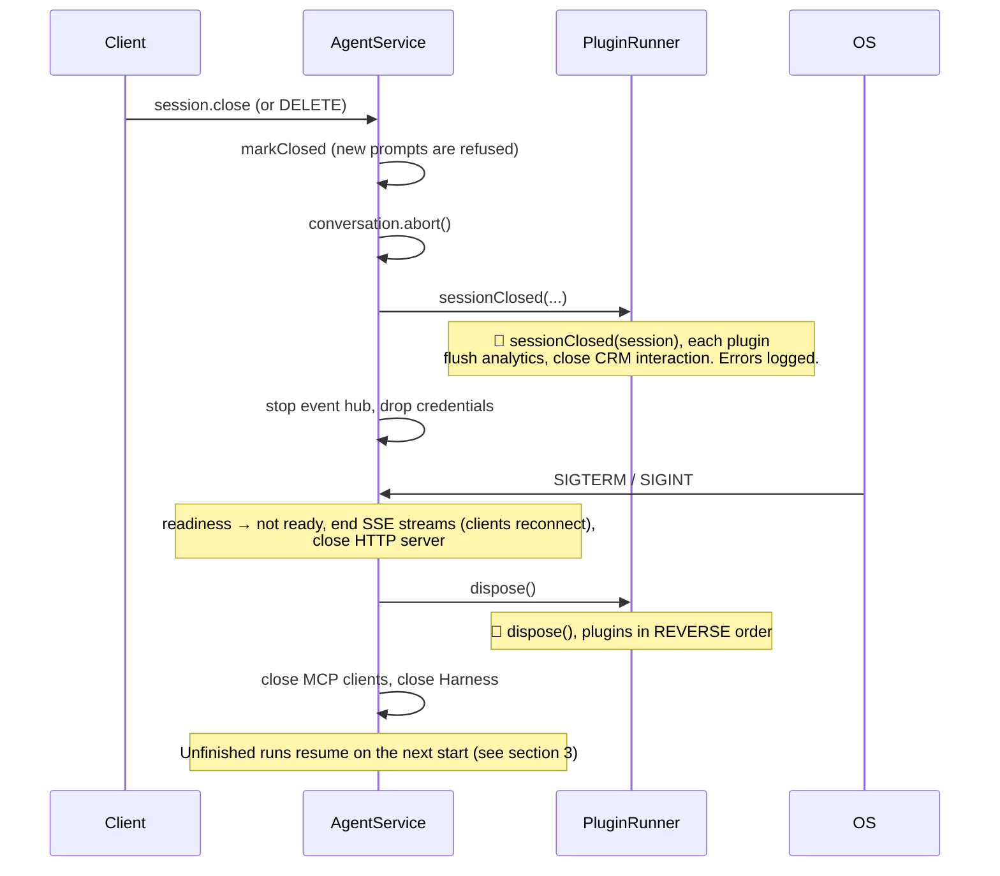

# Lifecycle and plugin hook points

This document follows one agent from process start to shutdown and marks where an `AgentPlugin` can step in. Hook
signatures are in `packages/agent-pi/src/plugins/types.ts`; the machinery is in `plugins/runner.ts`, `app.ts` and
`service.ts`.

Plugins run **in the order given** (`apps/assistant/src/plugins/index.ts`); each hook sees the effect of the earlier
plugins. Hooks are marked 🔌 in the diagrams.

## 1. Whole-system overview

Registration (section 2) happens once, before startup. Sections 3 to 9 follow the lifecycle in order; section 11 traces
the bundled plugins through it.



## 2. Plugin registration

A plugin is a plain object made with `definePlugin()`. Registering one means putting it in the `plugins` array that the
app hands to `runAgent`. Nothing is discovered automatically.

```ts
// apps/assistant/src/plugins/index.ts: the array order is the call order of every hook
export const plugins: readonly AgentPlugin[] = [guardrails, shortcuts({ ... }), clock({ ... }), audit];

// apps/assistant/src/main.ts
await runAgent({ config: new URL("../config/agent.json", import.meta.url), plugins });
```

`runAgent` → `startAgent(config, { plugins })` → `new PluginRunner(plugins, CORE_METHODS)`.



What a registered plugin is wired into, and where it is called from:

| Plugin member | Registered into | Called from |
|---|---|---|
| `register`, `setup`, `dispose` | `PluginRunner` loops | `startAgent` and `close()` in `app.ts` |
| `authenticate` | chained onto the base authenticator (`withExtension`) | HTTP layer, every request |
| `instructions` | durable `sections` of `plugin.NAME` | system prompt build, between configured instructions and the skill index |
| `tools` | durable `tools` of `plugin.NAME`, plus catalog server `NAME` | the model loop; found by skills, `search_tools`, preload, `alwaysOnTools` |
| `skills`, `mcpServers` | merged with the config's lists | skill index; MCP manager |
| `rpc` | `PluginRunner` method map | `dispatch` default branch in `streamable-http.ts` |
| `sessionCreated`, `sessionClosed`, `beforePrompt`, `afterRun` | called directly by `PluginRunner` | `AgentService` |
| `beforeModelRequest`, `afterModelResponse`, `onFinalAnswer` | `hook(GenerationTask, ...)` in `plugin.NAME` | durable model call |
| `beforeToolCall`, `afterToolCall` | `hook(ToolTask, ...)` in `plugin.NAME` | durable tool call |
| `mapEvent` | collected by `eventMapper()` | session event hub, per event |

The array order only decides the order within one hook. A plugin that omits a hook is skipped for it.

## 3. Process startup (`startAgent`, `app.ts`)

```mermaid
sequenceDiagram
    autonumber
    participant Main as main.ts / runAgent
    participant C as Container (IoC)
    participant PR as PluginRunner
    participant H as Harness (pi-durable)
    participant MCP as McpManager
    participant HTTP as HTTP server

    Main->>C: bindDefaults(log, models, storage, authenticator, identity, ...)
    Main->>PR: register(container)
    Note over PR,C: 🔌 plugin.register(container), in order.<br/>Rebind or decorate core services: authenticator, storage,<br/>models, Services.identityHeaders. Nothing is built yet.
    Main->>C: get(log, profiles, skills)
    Note over Main: skills = discovered + plugin.skills 🔌<br/>MCP servers = config + plugin.mcpServers 🔌
    Main->>PR: extensions(profileOf, credentials)
    Note over PR,H: 🔌 per plugin: durable extension "plugin.NAME"<br/>- instructions → prompt sections<br/>- tools → in-process tools (also catalogued under server NAME)<br/>- beforeModelRequest / afterModelResponse / onFinalAnswer → GenerationTask hooks<br/>- beforeToolCall / afterToolCall → ToolTask hooks
    Note over H: Prompt order: configured instructions, plugin sections,<br/>core (skill index, profile), identity
    Main->>H: Harness.open(storage, models, registry)
    Main->>PR: attach(runtime)
    Main->>PR: setup(container, config, catalog)
    Note over PR: 🔌 plugin.setup(host): services are built.<br/>Start webhooks and jobs; host.session(conversationId) reaches a session.
    Main->>H: harness.resume()
    Note over H: Unfinished runs continue. Durable hooks replay,<br/>so they must be deterministic or use ctx.memo().
    Main->>MCP: start(wait up to 10 s)
    Main->>PR: authenticator(base)
    Note over PR: 🔌 plugin.authenticate chained after the base authenticator
    Main->>HTTP: listen
```

| Phase | Hook | Typical use |
|---|---|---|
| 1 | `register(container)` | Replace or wrap the authenticator, storage, models. Bind the identity header resolver. Bind your own services (CRM client). |
| contributions | `instructions`, `tools`, `skills`, `mcpServers`, `rpc` | Static additions, read once at startup. |
| 2 | `setup(host)` | Needs built services (`harness`, `catalog`, other plugins' bindings); starts background work. |

## 4. Request path: authentication and dispatch



Authentication runs before any agent work. `authenticate` is the only hook that can refuse a caller before a session
exists. `sessionCreated` failures are only logged, so to refuse sessions, reject here.

## 5. Session creation



`SessionContext` gives the hook: ids, user and tenant, profile, metadata, the newest verified `principal` (can be
absent for resumed work), `history` (`say`, `exchange`, `record`), and `state` (the plugin's own durable document).

## 6. One turn: from prompt to settled run

This is where most hooks sit. Left side runs in the request (`AgentService.#admit`). Right side runs inside durable
tasks (`GenerationTask`, `ToolTask`), which can replay after a crash.



### Hook semantics at a glance

| Hook | When | Can do | Cannot do |
|---|---|---|---|
| `beforePrompt` | Before the input reaches the model, once per input | Rewrite input, preload tools, answer (`reply`), refuse (`reject`) | Not run again on a `requestId` retry |
| `beforeModelRequest` | Before each model request, including each tool round | Replace the messages for that request (dynamic context, redaction) | Changes are not stored |
| `afterModelResponse` | After every terminal model response | Observe | Cannot change the response |
| `onFinalAnswer` | The model produced a final answer | Force another round with `{ continue }` | |
| `beforeToolCall` | Before a tool executes | `block` or replace `arguments` | |
| `afterToolCall` | After a tool, before the result is stored | Replace the result | |
| `afterRun` | After a submission settles, whoever answered | Audit, analytics, CRM log | Never delays the answer |

Model and tool hooks receive a `ModelHookContext`. `state.get()` is read-only there and `memo()` stores computed
values, because the task can replay. `sessionId` and `userId` are `undefined` in a child conversation such as
`consult_expert`.

### Concurrency inputs

- **followUp** (default): queued, answered after the current run.
- **steer**: joins the running work after its current tool round. Runs `beforePrompt` like any input.
- **interrupt**: `conversation.abort()` first (the partial answer stays in storage, but the model no longer sees it), then a normal prompt. With `duringTools: "steer"`, running tools finish and the input joins the run as a steer.

A plugin `reply` while the session is busy is queued and enters the transcript at the next boundary.

## 7. Output path: events to the client



`mapEvent` is synchronous and runs once per event. `snapshot` events are the hub's own state and skip plugins. A
throwing mapper is logged and the unmodified event is delivered. Plugin replies, `history.say()` greetings and model
answers all travel this same path.

## 8. Session end and shutdown



## 9. Hook index by stage

| Stage | Hook | Order | Failure behavior |
|---|---|---|---|
| Startup | `register` | plugin order | Startup fails |
| Startup | `instructions`, `tools`, `skills`, `mcpServers`, `rpc` | plugin order | Name clashes fail startup |
| Startup | `setup` | plugin order | Startup fails |
| Request | `authenticate` | after base authenticator, plugin order | `AuthError` rejects |
| Request | `rpc[method]` | n/a | Normal JSON-RPC error |
| Session | `sessionCreated` | plugin order | Logged |
| Turn | `beforePrompt` | plugin order; first `reply` or `reject` ends the chain | `reject` gives 422; a throw fails the call |
| Turn | `beforeModelRequest`, `afterModelResponse`, `onFinalAnswer` | plugin order, inside `GenerationTask` | Durable task failure and retry rules apply |
| Turn | `beforeToolCall`, `afterToolCall` | plugin order, inside `ToolTask` | Same |
| Turn | `afterRun` | plugin order, background | Logged |
| Output | `mapEvent` | plugin order, per event | Logged, original event kept |
| End | `sessionClosed` | plugin order | Logged |
| Shutdown | `dispose` | **reverse** order | Logged |

## 10. The bundled assistant app

`apps/assistant/src/plugins/index.ts` registers four plugins in this order:

| Plugin | Hooks used | What it does at that stage |
|---|---|---|
| `guardrails` | `beforePrompt`, `afterToolCall` | First, so later plugins and the model only see input with card numbers removed. Removes card numbers from tool results before they are stored. |
| `shortcuts` | `beforePrompt` | Answers FAQ and shortcut inputs without the model (`reply`). |
| `clock` | `beforeModelRequest` | Inserts the current business time just before the latest user message on each request, fixed with `ctx.memo()` so a replay sees the same time. Not stored. |
| `audit` | `sessionCreated`, `afterRun` | One log line per session start and per settled run, with `answeredBy`, status and reason. |

## 11. Plugins being called: a trace through the bundled assistant

Order is `guardrails → shortcuts → clock → audit`. Each row shows which plugins are called at that point, in order.

```mermaid
sequenceDiagram
    autonumber
    participant Cl as Client
    participant G as guardrails
    participant Sh as shortcuts
    participant Ck as clock
    participant Au as audit
    participant M as Model

    Note over G,Au: Startup: register, setup run for each plugin that defines them.<br/>None of the four does; they contribute only hooks.
    Cl->>Au: session.create
    Note over Au: sessionCreated → logs audit.session_created
    rect rgb(240,248,255)
    Note over Cl,Au: Turn 1: "hello"
    Cl->>G: beforePrompt (no card number → pass)
    G->>Sh: beforePrompt → { reply: "Hi, I'm Ava..." }
    Note over Sh,M: Chain ends here. clock never runs for this turn.<br/>The model is not called.
    Sh-->>Au: afterRun (answeredBy: "shortcuts")
    end
    rect rgb(255,248,240)
    Note over Cl,Au: Turn 2: "my card is 4111 1111 1111 1111, what is the weather?"
    Cl->>G: beforePrompt → { input: redacted }
    G->>Sh: beforePrompt (sees redacted text; no match → pass)
    Note over Ck: clock has no beforePrompt, skipped
    Sh->>Ck: admission done; model request begins
    Note over Ck: beforeModelRequest → inserts &lt;now&gt; before the last user message
    Ck->>M: model request (guardrails and shortcuts have no model hooks)
    M-->>G: tool call (weather lookup)
    Note over G: afterToolCall → redacts card numbers in the result
    G->>Ck: next model round
    Note over Ck: beforeModelRequest again (memoized time)
    Ck->>M: model request
    M-->>Cl: final answer (streamed through mapEvent: none of the four define it)
    M-->>Au: afterRun (answeredBy: "model", status: done)
    end
    Cl->>Au: session.close → sessionClosed (audit does not define it, skipped)
    Note over G,Au: Shutdown: dispose runs in reverse order (audit, clock, shortcuts, guardrails);<br/>none of the four define it
```

Which hooks each bundled plugin implements:

| Hook | guardrails | shortcuts | clock | audit |
|---|:-:|:-:|:-:|:-:|
| `register` / `setup` / `dispose` | | | | |
| `instructions` / `tools` / `skills` / `rpc` | | | | |
| `authenticate` | | | | |
| `sessionCreated` | | | | ✔ |
| `beforePrompt` | ✔ (rewrite) | ✔ (reply) | | |
| `beforeModelRequest` | | | ✔ | |
| `afterModelResponse` / `onFinalAnswer` / `beforeToolCall` | | | | |
| `afterToolCall` | ✔ | | | |
| `afterRun` | | | | ✔ |
| `sessionClosed` / `mapEvent` | | | | |

## 12. Rules to keep in mind

- **Durable hooks may replay.** `beforeModelRequest`, `afterModelResponse`, `onFinalAnswer`, `beforeToolCall`,
  `afterToolCall` run inside durable tasks. Keep them deterministic, or wrap non-deterministic reads in `ctx.memo()`.
  Do not write plugin state from them.
- **Order matters.** Put redaction and policy plugins first, observers (audit) last.
- **Keep prompt sections stable** within a session; a changing section defeats prompt caching. Use
  `beforeModelRequest` for per-request context instead.
- **Credentials are time-limited.** `principal` can be absent in resumed runs, and after 30 minutes without a request
  on an idle session. Hooks that need the caller must handle `undefined`.
- **Identity reaches the gateway.** Each model call carries session, turn and user ids as headers; a plugin can
  customize them by binding `Services.identityHeaders` in `register()`. A child conversation such as `consult_expert`
  calls for its parent's session and turn.
- **Spans must not come from durable hooks.** Hooks can replay, which would report work twice. `agent.submission` is
  opened at admission, unless the input is a retry; `agent.model` wraps the provider call itself (`withModelSpans`), so
  a request sent twice shows twice; `agent.tool` comes from the event stream (`toolSpans`), upstream of `mapEvent`.
  Where a turn's work goes in its trace is stored with the turn, so a resumed run stays in that trace, though a span
  open when the process died is lost.
