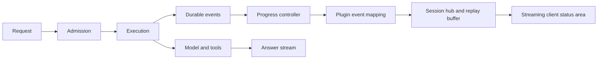

# Progress feedback

## Purpose

Give the user readable feedback while a request executes. Execution starts through the normal durable submission path; execution never waits for acknowledgement generation or playback. This improves time to visible feedback, not model time to first token.

Set `progressModel` to a configured model name to generate a friendly acknowledgement from the submitted input. The assistant uses `fast`. After admission, a separate, tool-free model call runs concurrently with the main task, capped at 100 output tokens and five seconds. It requests one short sentence in the user's language, with no claimed results. Errors are ignored; completion aborts the call; late output is suppressed once answer text has begun. Input uses the post-plugin rewritten text, limited to 8,000 characters.

Generated mode suppresses canned acknowledgement and waiting sentences. The existing client working indicator remains while generation is pending or fails. The generated text is published through the same temporary progress event and never enters model history or TTS. This adds an inference request, with cost and possible shared-provider contention; it cannot guarantee faster model first-token latency. Its usage is currently visible through the gateway, not included in durable conversation token totals.

Queued submissions and resumed runs currently use the working indicator without generating a new acknowledgement. This avoids describing queued work as already active. Without `progressModel`, the generic event-driven mode below remains available.

## Architecture

`events/progress.ts` observes lifecycle events in `SessionHub`. It emits presentation-only events through the same plugin mapping and replay buffer as other client events. It does not write assistant messages, alter prompts, or create background agents. Work already runs independently of the response connection.

In generic mode, an acknowledgement is emitted on `run.started`. Admission, authentication, and plugin hooks can still take time before that event. Clients should show a local pending indicator immediately on submission; this must not claim execution has begun.

## Protocol and lifecycle

A `progress` event contains:

| Field | Meaning |
|---|---|
| `submissionIds` | Submissions currently described by this status |
| `phase` | `working`, `waiting`, `retrying`, or `finished` |
| `text` | Display text; empty for `finished` |

Submission IDs are used because steering can join multiple inputs into one run. A placed input joining active work updates the IDs. Queued inputs do not get a working acknowledgement until they enter execution.

- Run start: emit “I’m working on your request.”
- Quiet for 12 seconds: emit “I’m still working on your request.” once. `waiting` means no recent visible activity, not a diagnosed external dependency.
- Text or tool activity: reset the quiet timer. Identical waiting text remains suppressed.
- Retry: emit “The request is being retried.”
- Submission `done` or `unanswered`: clear that submission's progress, including cancellation and failure outcomes. The submission event remains authoritative about the outcome.
- Run finish: clear the run's progress and stop the timer. Intermediate `message.end` and tool completion do not finish progress.
- Hub shutdown: dispose the timer.

Progress has no fabricated percentages, estimates, tool-derived findings, or raw tool arguments. Generic mode adds no model request; generated mode adds only the acknowledgement request, never duplicates task execution.

## Reconnect and replay

Ordinary reconnects replay buffered events using `Last-Event-ID`. A fresh subscription receives `snapshot.progress` containing the latest mapped status. In generic mode, a recreated hub or durable stream resync reconstructs a generic working status from active run inputs; prior wording and timers are not durable. An idle resync clears stale progress.

The latest snapshot removes settled submission IDs without clearing other submissions still running. Progress follows the hub's existing idle and detached shutdown policy.

## Client behavior

Render one replaceable status area per submission. Use `text.delta` for answer content and keep progress separate. Clear status on a finished progress event, a terminal submission, or an idle snapshot. If an answer arrives immediately, the client may suppress a brief acknowledgement flash. Replayed event IDs should not create duplicate status messages.

No frontend is bundled in this repository. Existing clients can ignore the additive event. JSON-only calls retain their result format; progress requires SSE, either on the prompt response or the session GET stream.

Progress does not automatically enter speech or conversation history. A voice client can speak the initial acknowledgement once, interrupt it for final-answer speech, and suppress routine waiting notices. `session.history.say()` is unsuitable for this purpose because busy-session messages are queued at turn boundaries.

Plugins may customize or suppress progress with `mapEvent`. Keep mapping synchronous and inexpensive. Returning an empty event list suppresses progress, including the latest mapped snapshot status.

## Measurement and validation

Run `npx vitest run packages/agent-pi/test/progress.test.ts`.

The transport test uses real local HTTP streaming and a scripted model with a 600 ms delay. It compares progress suppressed through event mapping with progress enabled, recording model-start latency, first readable feedback, and first answer text. Suppressing progress is a presentation baseline, not an old-version performance benchmark.

An initial sample measured feedback at 641 ms with progress hidden and 6 ms with progress enabled; answer text arrived at 641 ms and 608 ms respectively. This single sample demonstrates earlier feedback under artificial delay. It does not demonstrate improved model token latency or production latency. Warm-up and scheduling can explain differences in answer time.

Production evaluation should record distributions of admission latency, first progress delivery, first answer token, and completion time. Compare equivalent workloads and model settings, and include client rendering and proxy buffering. Task-specific acknowledgements should only be added if their UX value warrants their cost; they must never block execution.

Live provider check (2026-11-03): the configured `qwen3.5-flash` initially exhausted the acknowledgement token cap on reasoning with no text. Acknowledgement requests for Qwen models now send `enable_thinking: false`. A standalone provider check then produced a CRM-comparison acknowledgement in 954 ms. This measures only that acknowledgement call, not end-to-end chat latency. Transport tests separately cover concurrent generation, exclusion from history, and discarding a late acknowledgement.
